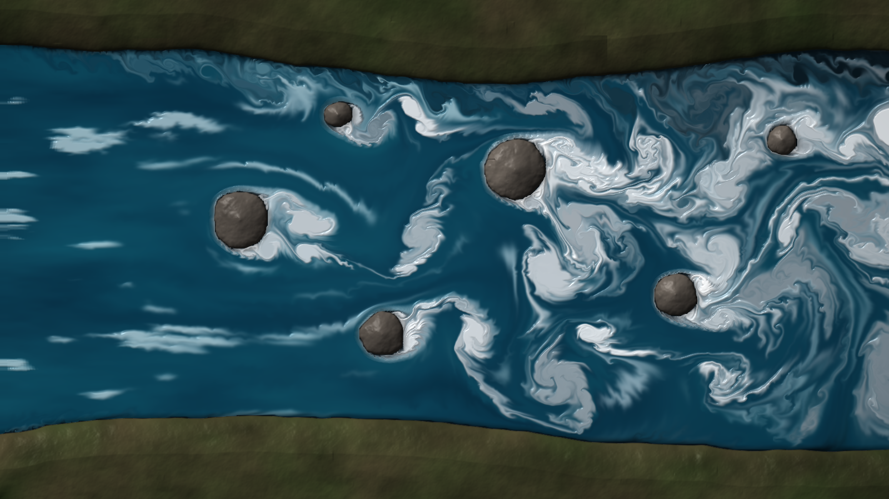
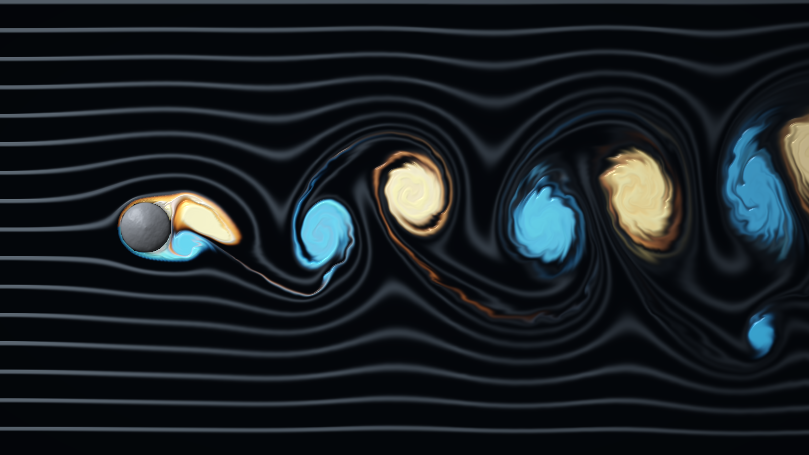
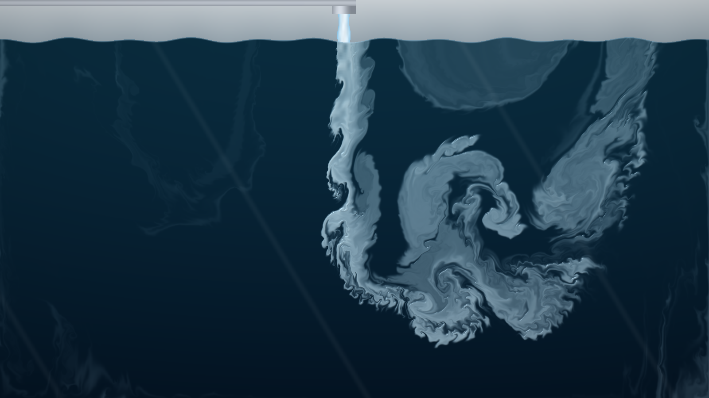
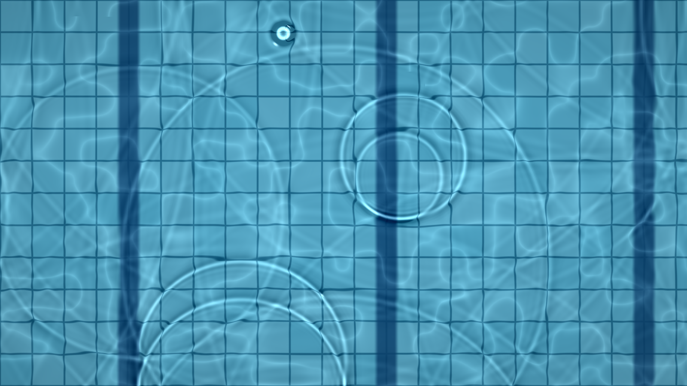

# Navier–Stokes

Five full-screen, interactive water simulations that solve the Navier–Stokes equations live on your GPU, right in the browser.

| | |
|---|---|
|  **1 · River & Rocks** |  **2 · Vortex Street** |
|  **3 · Faucet Plunge** |  **4 · Whirlpool Drain** |
|  **5 · Ripple Pool** | Drag to stir · keys **1–5** switch · **F** full screen · **⌘,** settings |

**Run it:** `python3 -m http.server 8765`, then open <http://localhost:8765>

- [Instructions](docs/INSTRUCTIONS.md): setup, running, controls, settings, testing
- [System design](docs/SYSTEM-DESIGN.md): architecture, solver, design decisions, limits
- [File structure](docs/FILE-STRUCTURE.md): what's where
