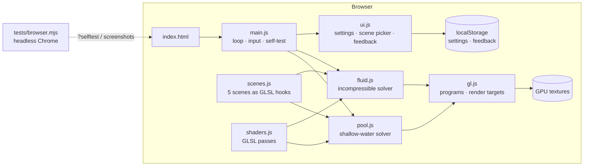

# System Design

Navier–Stokes is a static website: one HTML page and plain JavaScript files that run five 2D fluid simulations on the GPU through WebGL 2. There's no build step, no server code and no dependencies.

## Architecture

## Components

| Component | Job |
|---|---|
| `index.html`, `css/style.css` | Full-screen canvas plus overlay controls: title, scene picker, equations card, settings panel, feedback tab, stats. |
| `js/gl.js` | WebGL 2 setup, shader compile and link with readable errors, half- and full-float render targets, ping-pong pairs, one-call full-screen passes, read-back for tests. |
| `js/shaders.js` | Every GLSL pass. Each fragment program is built as *header + scene hooks + pass body*. |
| `js/scenes.js` | The five demos. A fluid scene supplies GLSL hooks: `sceneSDF` (solids), `sceneForce` (inflow, gravity, swirl), `sceneSource` (mass sinks), `sceneDye` (where colour enters), and `sceneBackground` / `sceneSolid` / `sceneDecor` (looks). It also supplies its boundary modes and tuned constants. |
| `js/fluid.js` | Incompressible Navier–Stokes solver used by scenes 1–4. |
| `js/pool.js` | Shallow-water solver used by scene 5. |
| `js/ui.js` | Settings (saved in the browser), the settings panel (⌘, or Ctrl+,), keyboard shortcuts, the scene picker, the equations card, the feedback panel, and idle auto-hide. |
| `js/main.js` | Canvas sizing, pointer and touch input turned into force/dye splats, the frame loop, scene switching, URL options, and the `?selftest` runner. |
| `tests/browser.mjs` | Drives headless Chrome over the DevTools protocol to run the self-test and take README screenshots. |

## Main flows

**Each frame, scenes 1–4** (`Fluid.step`), operator-split "stable fluids" (Stam 1999):

1. **Forces.** Explicit viscosity `ν∇²u`, then the scene's body forces and inflow.
2. **Vorticity confinement.** Adds back the small swirls that the grid's numerical diffusion smears out.
3. **Pointer splats.** A Gaussian of velocity and dye at each dragged pointer.
4. **Projection.** Compute `∇·u − s` (s is the scene's source, e.g. the drain). Solve `∇²p = ∇·u − s` with multigrid V-cycles, then `u −= ∇p`.
5. **Advection.** Semi-Lagrangian advection of velocity, then of dye, after the scene injects dye.

**Each frame, scene 5** (`Pool.step`): rain and pointer drops dent the surface. Then, in CFL-limited substeps: update velocity (advection, viscosity, `−g∇η`, friction), then update height (`∂η/∂t = −H∇·u`).

**Render.** One display pass draws the chosen view: water (dye with fake lighting from its gradient), speed, vorticity, or pressure/height. Solids are drawn from their analytic SDF at screen resolution, so rocks stay crisp at any grid size.

**Switching scenes** compiles that scene's programs once (cached), allocates textures sized to the window and quality setting, and rasterises the solids.

## Where data lives

- **Simulation state** stays on the GPU in float textures. Velocity, pressure, divergence, the multigrid levels and the pool height use 32-bit floats. Dye, curl and solid masks use 16-bit floats. Nothing is sent anywhere.
- **Settings** (`navier-stokes.settings`) and **feedback notes** (`navier-stokes.feedback`) live in the browser's `localStorage`. Feedback leaves the browser only when the user copies or downloads it.

## Key design decisions

| Decision | Why | Trade-off |
|---|---|---|
| WebGL 2 fragment-shader solver | Runs at full screen and 60 fps on ordinary laptops; no install. | Needs `EXT_color_buffer_float`, which is present on modern desktop and phone GPUs but missing on some old ones. |
| **Staggered (MAC) grid** | Each texel stores *u on its right face* and *v on its top face*. Divergence and gradient become one-cell differences that exactly match the 5-point Laplacian, so the projection really reaches zero divergence. The usual collocated grid leaves a residual it can never remove. | Slightly more complex sampling: `sampleVel` offsets by half a cell. |
| **Multigrid pressure solve** | Plain Jacobi barely touches large-scale modes: 3000 sweeps left about 90% of the divergence. One V-cycle cuts divergence about 100×, so inflows, outlets and the drain behave properly. | More passes and textures per level. About as costly as 30 Jacobi sweeps per cycle. |
| 32-bit floats for velocity and pressure | Half floats put a precision floor on the projection and lost 19% of the pool's water over 2 s. | Twice the memory bandwidth for those textures. |
| Scenes as GLSL hooks | Five quite different setups (inflow and outlet, closed tank, drain sink, obstacles) share one solver. | Each scene compiles its own program set, about 20 ms on first visit. |
| Shallow-water equations for the pool | Incompressible 2D flow has no free surface, so it can't make ripples. Depth-averaged Navier–Stokes can. | Linear in depth (`H∇·u`, not `∇·((H+η)u)`). Fine for ripples, not for breaking waves. |
| Plain `<script>` files, no modules | `index.html` also works when opened straight from disk. | Shared `window.NS` namespace instead of imports. |

Boundary modes, per side (L, R, B, T): **wall** (no flow through, pressure mirrored), **open** (`p = 0` on the face, so fluid can leave or enter), **inflow** (velocity set by the scene, pressure mirrored).

## Testing

- **`?selftest`** runs each scene for 150 frames and checks it:
  - No NaN or Inf anywhere.
  - One projection reduces divergence more than 10×. Typical results are 150–600×.
  - Solid cells have zero velocity.
  - The fluid is moving, and inflow scenes have net left-to-right flow.
  - The pool keeps its total water volume (drift under 1%, measured about 1e-8).
- `node tests/browser.mjs selftest` runs that in headless Chrome and exits non-zero on failure.
- `node tests/browser.mjs screenshots` regenerates `docs/images/scene-*.png`, which works as a visual regression check.

## Known limits

- 2D only, on a fixed grid. Semi-Lagrangian advection adds numerical viscosity, so the Reynolds number shown for the vortex street is *nominal*: the effective viscosity is higher than the slider value.
- Vorticity confinement is an artistic correction, not physics. Set "Swirl detail" to 0 for the plain solver.
- Explicit viscosity is capped per step for stability, so very high viscosity settings saturate.
- Solids are rasterised to grid cells (staircase boundaries). They're drawn smooth, but the flow sees the steps.
- Resizing the window restarts the simulation.
- Needs WebGL 2 with float render targets. Without it, the page shows a plain message.
